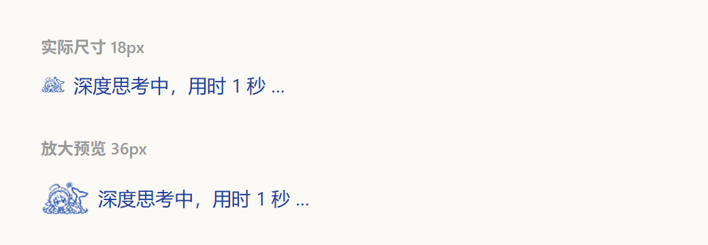

# DSH-Thinking-Icon
用于替换dsh的深度思考摆鱼尾的小动画
# DSH Thinking Icon

把 DeepSeek Harness 聊天界面里「深度思考中」左边那颗动态鲸鱼尾小图标，替换成你自己的贴纸 GIF。



## 效果

- 思考进行中时，状态行左侧的小图标显示为这张贴纸（18px，含 4 帧轻微呼吸动画）。
- 其它 UI、功能、数据完全不变。

## 安装

1. 退出 DeepSeek Harness（托盘里也要退出）。
2. 双击 `安装.cmd`。
3. 按提示完成后，重新打开 DeepSeek Harness。

> 如果 Windows 提示「已保护你的电脑」或 SmartScreen 拦截，点「更多信息 → 仍要运行」。
> 如果是从网上下载的压缩包，建议先右键 zip → 属性 → 勾选「解除锁定」再解压。

如果自动找不到安装目录，可以手动指定：

```powershell
powershell -ExecutionPolicy Bypass -File tools\install.ps1 -AsarPath "D:\你的安装目录\resources\app.asar"
```

## 还原

双击 `还原.cmd`，会从 `app.asar.bak` 恢复原始文件，然后重启应用。

如果应用在这之后升级过，还原脚本会检测到指纹不一致并提示确认（避免把新版本降级成旧版本）。

## 原理与安全性

- 只改 `resources\app.asar` 里 `@deepseek-ai/dsh-client-ui-chat/lib/client.js` 的一段 CSS：把原来的 `mask` 遮罩图换成内嵌的贴纸 GIF。
- 采用**等长字节替换**：asar 文件头、文件大小、其它 18000+ 个文件均不变，不使用重打包。
- 安装前自动备份为 `app.asar.bak`；安装后自动校验，校验失败会自动回滚。
- 不联网、不写注册表、不安装服务。

## 兼容性

- 在 DeepSeek Harness 0.2.1-rc.2（Windows x64）上测试通过。
- 如果版本更新后提示「未找到运行图标规则」，说明该版本 UI 结构变化，需要更新本工具。
- 应用升级/重装后需要重新安装一次（升级会覆盖 app.asar）。

## 已知限制

- 图标实际只有 18px，贴纸细节多，缩小后会偏糊，能看出蓝色小人但看不清五官。
- 深色主题下贴纸仍是蓝白色，不会跟随主题变色（原图标是单色遮罩）。

## 卸载

还原后删除整个文件夹即可；`app.asar.bak` 也可以一并删除。

## License

仅用于个人美化，贴纸素材版权归原作者所有。
